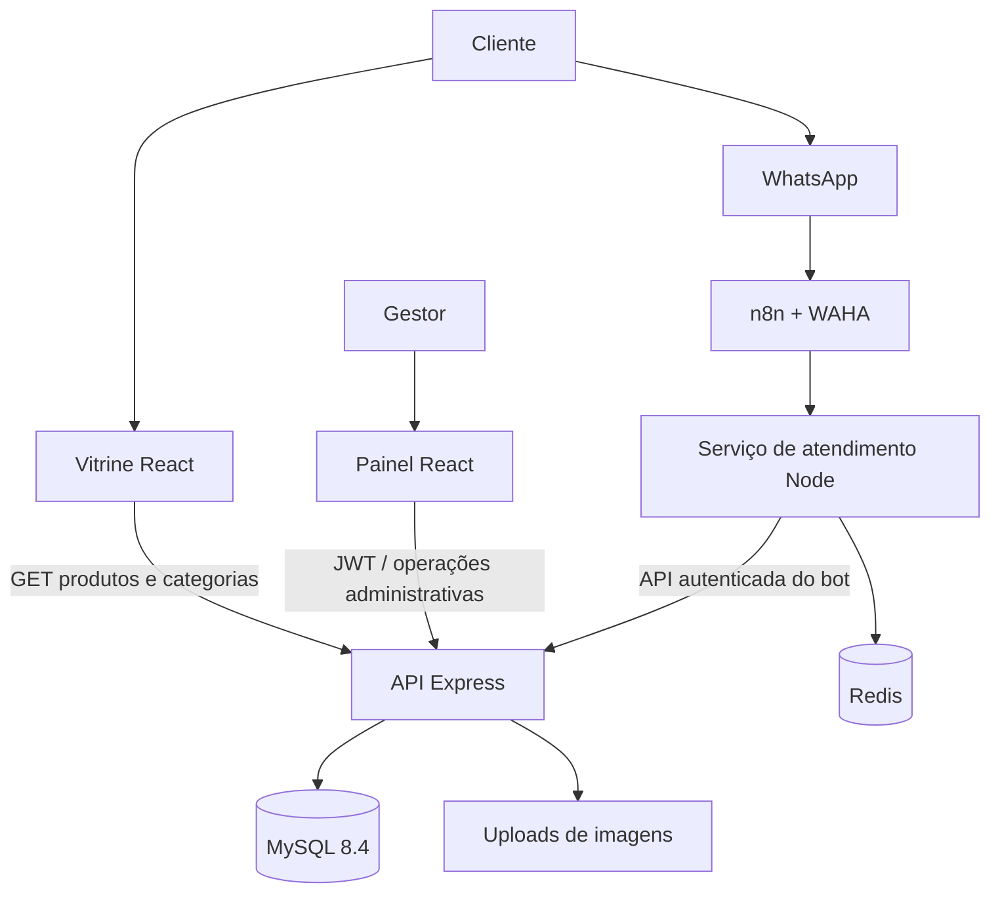

# Doce & Carinho

Sistema de operação e vendas para uma confeitaria: vitrine pública, painel de gestão, API, banco MySQL e atendimento automatizado pelo WhatsApp.

> **Estado do pacote:** código de apresentação/desenvolvimento atualizado em 01/11/2026. O fluxo de entrega está configurado para demonstração por cidade; não representa cotação real de rota. O atendimento WhatsApp está restrito a um telefone de teste.

## Visão geral



### Aplicações

| Parte | Diretório | Responsabilidade | Tecnologias |
|---|---|---|---|
| Vitrine | `vitrine-cliente/` | Cardápio público, categorias, busca, carrinho e encaminhamento do pedido ao WhatsApp | React 18, TypeScript, Vite, Tailwind |
| Painel | `painel-admin/` | Login, resumo, pedidos, produtos, categorias, insumos, estoque e auditoria | React 18, TypeScript, Vite, React Router, Tailwind |
| API | `backend/` | Autenticação, regras de negócio, pedidos, estoque, uploads, auditoria e endpoints do bot | Node.js, Express, TypeScript, MySQL2, JWT |
| Atendimento | `bot-whatsapp/` | Conversa guiada, sacola, deduplicação, integração com Redis, n8n e WAHA | Node.js, JavaScript, Redis |
| Infraestrutura | raiz e `bot-whatsapp/` | MySQL, Redis, n8n, WAHA e serviço de atendimento em Docker | Docker Compose |

## Como funciona

1. A vitrine consulta categorias e produtos ativos na API. O cliente monta a sacola e pode encaminhar o pedido pelo WhatsApp.
2. O atendimento recebe mensagens pelo WAHA; o workflow n8n encaminha o conteúdo ao serviço Node.
3. O bot conduz o fluxo de atendimento, mantém estado temporário no Redis e chama a API para consultar disponibilidade e registrar pedidos.
4. A API recalcula valores, valida as regras, grava o pedido e atualiza estoque em transações no MySQL.
5. O gestor acompanha pedidos no painel, altera etapas, confirma pagamentos e administra produtos e insumos.
6. A API registra alterações relevantes e tenta enviar avisos de andamento pelo WhatsApp, respeitando as travas contra duplicação.

## Funcionalidades identificadas

- Cardápio com categorias, produtos, busca, destaques e demonstração local.
- Sacola/carrinho e composição de mensagem para WhatsApp.
- Painel autenticado por JWT.
- Cadastro e edição de produtos, categorias e insumos.
- Ficha técnica produto–insumo e estimativa de disponibilidade conforme estoque.
- Movimentações de estoque e trilha de auditoria com valores anteriores e posteriores.
- Gestão de pedidos, etapas, cancelamento e restauração de estoque.
- Registro de pagamento e avisos com proteção contra duplicação.
- Upload de imagens JPG, PNG e WebP com limite de 5 MB.
- Bot com atendimento guiado, persistência temporária no Redis e chave de idempotência no pedido.
- Opção de retirada ou entrega; modo de demonstração usa taxas fixas por município.

## Estrutura principal

```text
.
├── backend/
│   ├── src/
│   │   ├── config/        # banco, ambiente e CORS
│   │   ├── controllers/   # endpoints e coordenação das operações
│   │   ├── middleware/    # JWT e autenticação do bot
│   │   ├── routes/        # rotas HTTP
│   │   ├── services/      # auditoria, entrega, uploads e avisos
│   │   └── lib/           # regras e utilitários
│   ├── seed/              # schema, dados iniciais e migrações
│   └── test/              # testes automatizados
├── painel-admin/src/
│   ├── components/        # componentes reutilizáveis
│   ├── hooks/             # estado e integração por domínio
│   ├── lib/api/           # cliente HTTP e módulos da API
│   ├── pages/             # telas do painel
│   └── types/             # contratos TypeScript
├── vitrine-cliente/src/
│   ├── components/        # interface da loja
│   ├── hooks/             # cardápio, carrinho e avisos
│   ├── lib/               # API, formatação e mensagem WhatsApp
│   └── types/
├── bot-whatsapp/
│   ├── src/               # conversa, remetente e servidor
│   ├── test/
│   └── atendimento.n8n.json
├── marca/                 # logos e ícones-fonte
└── midias/                # materiais de divulgação
```

## Requisitos

- Node.js 22 (recomendado para o serviço de atendimento) e npm.
- Docker Desktop com Docker Compose.
- MySQL 8.4 (o Compose da raiz fornece o serviço).
- Para atendimento completo: Redis, n8n e WAHA (Compose em `bot-whatsapp/`).

## Configuração local

Os arquivos `.env` reais não fazem parte deste repositório. Crie os arquivos locais a partir dos exemplos e preencha valores próprios:

```bash
cp .env.example .env
cp backend/.env.example backend/.env
cp vitrine-cliente/.env.example vitrine-cliente/.env
cp painel-admin/.env.example painel-admin/.env
cp bot-whatsapp/.env.example bot-whatsapp/.env.local
```

No Windows PowerShell, use `Copy-Item` no lugar de `cp` se necessário.

**Nunca coloque segredos em variáveis `VITE_*`: elas são incorporadas ao JavaScript entregue ao navegador.** Não reutilize senhas, tokens ou chaves de outro computador.

## Instalação e execução

Instale dependências em cada pacote:

```bash
npm ci
npm ci --prefix backend
npm ci --prefix painel-admin
npm ci --prefix vitrine-cliente
npm ci --prefix bot-whatsapp
```

Suba o MySQL:

```bash
docker compose up -d mysql
```

Em terminais separados, inicie API, painel e vitrine:

```bash
cd backend && npm run dev
cd painel-admin && npm run dev
cd vitrine-cliente && npm run dev
```

Para executar o bot, configure as variáveis de `bot-whatsapp/.env.local` e siga `bot-whatsapp/README.md`. Os serviços de infraestrutura do bot são independentes do Compose principal.

## Banco de dados

- `backend/seed/schema.sql`: estrutura inicial das tabelas.
- `backend/seed/seed.sql`: dados demonstrativos de catálogo e ficha técnica.
- `backend/seed/migracoes.sql`: alterações incrementais do esquema.
- `backend/seed/refazer-cardapio.sql`: script específico de atualização do cardápio.

Aplique schema e seed somente em uma base nova ou após backup. Migrações devem ser avaliadas e executadas na ordem adequada ao estado da base. Não restaure dumps de produção ou backups pessoais em ambientes públicos.

## Testes e builds

```bash
cd backend && npm test
cd bot-whatsapp && npm test
cd painel-admin && npm run build
cd vitrine-cliente && npm run build
```

O pacote inclui testes de unidade/integrados no backend e testes do fluxo de conversa do bot. A execução completa depende das dependências e, para testes que acessam banco, de uma instância MySQL configurada.

## Entregas: modo demonstração x real

O comportamento descrito em `backend/ENTREGAS.md` usa `ENTREGA_MODO=demonstracao`: valores fixos por cidade (Tietê, Jumirim e Cerquilho), sem consulta de rota. Isso é adequado para apresentação, não para cobrar frete real. Para operação real, configure as APIs do Google Maps, restrinja a chave no servidor e valide custos, cobertura e regras comerciais antes de ativar.

## Segurança e limitações conhecidas

- Use repositório **privado** enquanto o projeto não passar por uma revisão de privacidade e segurança.
- `.env`, `.env.local`, chaves, tokens, sessões, dumps de banco e dados de clientes não devem ser versionados.
- O backup de apresentação original foi deliberadamente omitido desta cópia Git: continha telefone e histórico de pedidos associados a uma pessoa, além de hash de senha de administrador.
- O bot está em modo de teste e limitado a um telefone autorizado. Não o habilite para clientes reais sem revisar autenticação, consentimento, observabilidade, retentativas e proteção contra abuso.
- Fotos enviadas pelo painel ficam em `backend/uploads`; em produção precisam de volume persistente ou armazenamento de objetos e política de backup.
- A cotação de entrega demonstrativa não usa rotas reais. Não apresente as distâncias ou taxas fixas como cotação logística real.
- Revise CORS, JWT, rate limiting, política de senhas, backups, logs e permissões antes de expor a API à internet.

## Documentação complementar

- `LEIA-ME-PRIMEIRO.md`: notas do pacote original e inicialização local.
- `painel-admin/README.md`: telas, rotas e organização do painel.
- `vitrine-cliente/README.md`: funcionamento e estrutura da vitrine.
- `backend/ENTREGAS.md`: regras de entrega, cotação e avisos.
- `bot-whatsapp/README.md`: infraestrutura e fluxo de atendimento.
